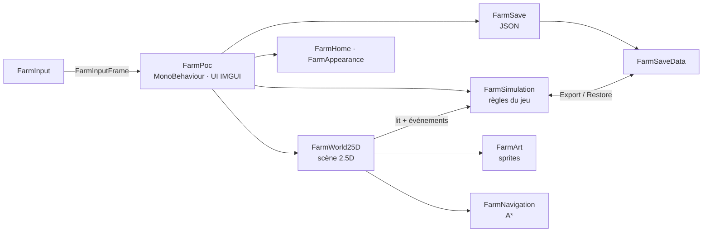

# Schéma UML — Farm Game POC

Diagramme de classes de l'architecture actuelle (code runtime de `Assets/Scripts`, hors outils éditeur).
Seuls les membres publics les plus utiles sont listés ; les classes `partial` sont regroupées en une seule boîte.

GitHub affiche les diagrammes Mermaid ci-dessous ; des versions image sont aussi disponibles :
[vue d'ensemble](uml-vue-ensemble.png) · [diagramme de classes](uml-classes.png).

## Vue d'ensemble

## Diagramme de classes

```mermaid
classDiagram
    direction LR

    namespace Controle {
        class FarmPoc {
            <<MonoBehaviour>>
            +FarmSimulation State
            +FarmWorld25D World
            +FarmHome Home
            +FarmAppearance Appearance
            +FarmTool ActiveTool
            +bool Crafting
            +bool BuildPlacing
            -View view
            -FarmArt art
            -FarmInput controls
            -FarmSave storage
            +ProcessInput(FarmInputFrame f)
            +ProcessPointerClick(Vector2 screen, bool secondary) bool
            +OpenCrafting()
            +OpenFarmPlacement(int recipe)
            +SaveGame(bool manual) bool
            +LoadGame(bool backup) bool
        }
        class View {
            <<enumeration>>
            Play
            Wheel
            Inventory
            Shop
            Sleep
            Style
            Decoration
            Pause
            LoadConfirm
            QuitConfirm
            Land
            Craft
        }
        class FarmInput {
            +bool UsingGamepad
            +bool UsingMouse
            +bool HasGamepad
            +Read(float time) FarmInputFrame
        }
        class FarmInputFrame {
            <<struct>>
            +Vector2 Move
            +Vector2 PointerPosition
            +Vector2Int Navigate
            +bool Confirm
            +bool Cancel
            +bool Build
            +int DirectTool
        }
        class FarmToolWheel {
            <<static>>
            +Select(Vector2 direction, int previous) int
        }
    }

    namespace Monde {
        class FarmWorld25D {
            <<IDisposable>>
            +Camera Camera
            +Transform Player
            +bool Indoors
            +bool NearWorkbench
            +bool NearShop
            +Update(float delta, Vector2 input, bool canMove, ...)
            +Refresh(int x, int z)
            +ApplyHome(FarmHome home)
            +ApplyAppearance(FarmAppearance a)
            +PickInteraction(Vector2 screen) FarmInteraction
            +Navigation() FarmNavigation
            +DecorBlocked(int x, int z, int ignore, out bool player) bool
            +ShowDecorGhost(int kind, int x, int z, bool valid)
            +ShowFurnitureGhost(FarmFurniture item, bool valid)
            +SetCraftTime(float seconds)
            +Dispose()
        }
        class FarmInteraction {
            <<enumeration>>
            None
            House
            Shop
            Wardrobe
            DecorChest
            Exit
            Workbench
        }
        class FarmArt {
            <<IDisposable>>
            +GetSprite(Kind kind) Sprite
            +CropSprite(int kind) Sprite
            +HomeSprite(int kind, bool side) Sprite
            +AvatarPart(FarmAppearance a, int part) Sprite
            +Release(Object item)$
        }
        class FarmNavigation {
            +FarmNavigation(Rect bounds, canStand, canTravel, float step)
            +FindPath(Vector2 from, Vector2 to, out List~Vector2~ path) bool
        }
    }

    namespace Simulation {
        class FarmSimulation {
            +int Width$
            +int Height$
            +CropDefinition[] Crops$
            +FarmPlot[,] Plots
            +int[] Seeds
            +int[] Products
            +int[] Crafted
            +List~FarmDecor~ Decor
            +int Day
            +double Hour
            +int Money
            +int UnlockedLand
            +Till(int x, int z, out string msg) bool
            +Plant(int x, int z, out string msg) bool
            +Water(int x, int z, out string msg) bool
            +Harvest(int x, int z, out string msg) bool
            +BuySeeds(int kind, int amount, out string msg) bool
            +Sell(int kind, int amount, out string msg) bool
            +BuyLand(int lot, out string msg) bool
            +CanCraft(int recipe) bool
            +Craft(int recipe, out string msg) bool
            +SellCrafted(int recipe, int amount, out string msg) bool
            +PlaceDecor(int kind, int x, int z, int moving, out string msg) bool
            +RemoveDecor(int index, out string msg) bool
            +AdvanceRealSeconds(double seconds)
            +Export(FarmSaveData save)
            +Restore(FarmSaveData save)
            PlotChanged event
            NewDay event
            LandChanged event
            DecorChanged event
        }
        class FarmPlot {
            +bool Tilled
            +int UsesLeft
            +int Crop
            +int WateredDay
            +double GrowthHours
            +PlantStage Stage
        }
        class CropDefinition {
            +string Name
            +double GrowthHours
            +int SeedPrice
            +int SalePrice
            +int Yield
        }
        class PlantStage {
            <<enumeration>>
            Empty
            Seed
            Sprout
            Mature
        }
        class FarmTool {
            <<enumeration>>
            Hoe
            Seeds
            Water
            Basket
            House
            Wardrobe
        }
        class FarmLand {
            <<static>>
            +FarmLandDefinition[] Lots$
            +At(int x, int z) int$
            +Cultivable(int x, int z, int unlocked) bool$
        }
        class FarmLandDefinition {
            +string Name
            +int Price
            +int X
            +int Z
            +int Width
            +int Depth
            +Contains(int x, int z) bool
        }
        class FarmCrafting {
            <<static>>
            +float CraftSeconds$
            +CraftRecipe[] Recipes$
        }
        class CraftRecipe {
            +string Name
            +string Category
            +FarmArt.Kind Icon
            +int[] Crops
            +int Coins
            +int SalePrice
            +float DecorHeight
            +bool Placeable
        }
        class FarmDecor {
            <<Serializable>>
            +int Kind
            +int X
            +int Z
        }
    }

    namespace Maison {
        class FarmHome {
            +int Width$
            +int Depth$
            +FarmFurnitureDefinition[] Catalog$
            +int Wallpaper
            +int Floor
            +List~FarmFurniture~ Furniture
            +Starter() FarmHome$
            +At(int x, int z) int
            +CanPlace(FarmFurniture item, int ignore, out string msg) bool
            +Place(FarmFurniture item, int replace, out string msg) bool
            +Valid() bool
        }
        class FarmFurniture {
            +int Kind
            +int X
            +int Z
            +int Rotation
            +int Width
            +int Depth
            +Contains(int x, int z) bool
        }
        class FarmFurnitureDefinition {
            +string Name
            +int Width
            +int Depth
        }
        class FarmAppearance {
            +int Skin
            +int Hair
            +int HairColor
            +int Eyes
            +int Mouth
            +int Top
            +int Bottom
            +int Shoes
            +Get(int category) int
            +Set(int category, int value)
            +Valid() bool
        }
    }

    namespace Sauvegarde {
        class FarmSave {
            +string Path
            +bool Exists
            +Write(FarmSaveData data, out string msg) bool
            +Read(out FarmSaveData data, out string msg, bool backup) bool
        }
        class FarmSaveData {
            <<Serializable>>
            +int Version
            +int Day
            +int Money
            +int[] Seeds
            +int[] Products
            +int[] Crafted
            +FarmPlot[] Plots
            +FarmDecor[] Decor
            +FarmHome Home
            +FarmAppearance Appearance
            +Vector3 PlayerPosition
            +Valid() bool
        }
    }

    %% Contrôle
    FarmPoc *-- FarmSimulation : State
    FarmPoc *-- FarmWorld25D : World
    FarmPoc *-- FarmInput : controls
    FarmPoc *-- FarmSave : storage
    FarmPoc *-- FarmArt : art
    FarmPoc *-- FarmHome : Home
    FarmPoc *-- FarmAppearance : Appearance
    FarmPoc --> View
    FarmPoc ..> FarmToolWheel
    FarmPoc ..> FarmTool
    FarmInput ..> FarmInputFrame : produit

    %% Monde
    FarmWorld25D o-- FarmSimulation : lit, s'abonne
    FarmWorld25D o-- FarmArt
    FarmWorld25D ..> FarmNavigation : crée
    FarmWorld25D ..> FarmInteraction
    FarmWorld25D ..> FarmHome : affiche

    %% Simulation
    FarmSimulation *-- "15x11" FarmPlot
    FarmSimulation *-- "0..60" FarmDecor
    FarmSimulation ..> CropDefinition
    FarmSimulation ..> FarmLand
    FarmSimulation ..> FarmCrafting
    FarmPlot --> PlantStage
    FarmLand *-- "7" FarmLandDefinition
    FarmCrafting *-- "6" CraftRecipe
    FarmDecor ..> CraftRecipe : Kind = index

    %% Maison
    FarmHome *-- "*" FarmFurniture
    FarmHome *-- "8" FarmFurnitureDefinition : Catalog
    FarmFurniture ..> FarmFurnitureDefinition : Kind = index

    %% Sauvegarde
    FarmSave ..> FarmSaveData : lit / écrit
    FarmSaveData o-- FarmPlot
    FarmSaveData o-- FarmDecor
    FarmSaveData o-- FarmHome
    FarmSaveData o-- FarmAppearance
    FarmSimulation ..> FarmSaveData : Export / Restore
```

## Découpage des classes `partial`

| Classe | Fichiers | Responsabilité de chaque fichier |
|---|---|---|
| `FarmPoc` | `FarmPoc.cs` | Boucle `Update`, vues, HUD, inventaire, boutique |
| | `FarmPocHome.cs` | Maison, garde-robe, sauvegarde / chargement, pause |
| | `FarmPocMouse.cs` | Clics, déplacement à la souris, interactions |
| | `FarmPocCrafting.cs` | Catalogue de l'établi et animation de fabrication |
| | `FarmPocBuild.cs` | Menu de construction et pose (meubles + décorations) |
| `FarmWorld25D` | `FarmWorld25D.cs` | Scène extérieure, caméra, personnage, éclairage |
| | `FarmInterior25D.cs` | Intérieur de la maison et meubles |
| | `FarmWorldMouse.cs` | Picking, points d'approche, collisions de marche |
| | `FarmWorldCrafting.cs` | Établi et son animation |
| | `FarmWorldPlacement.cs` | Décorations posées et fantômes de pose |
| `FarmArt` | `FarmArt.cs`, `FarmCharacterArt.cs`, `FarmHomeArt.cs` | Sprites généraux, avatar, maison |
| `FarmSimulation` | `FarmSimulation.cs`, `FarmCrafting.cs` | Cultures / temps / argent, fabrication / décorations |
