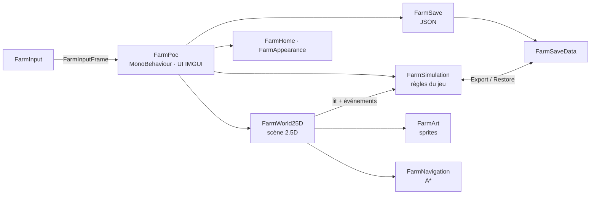
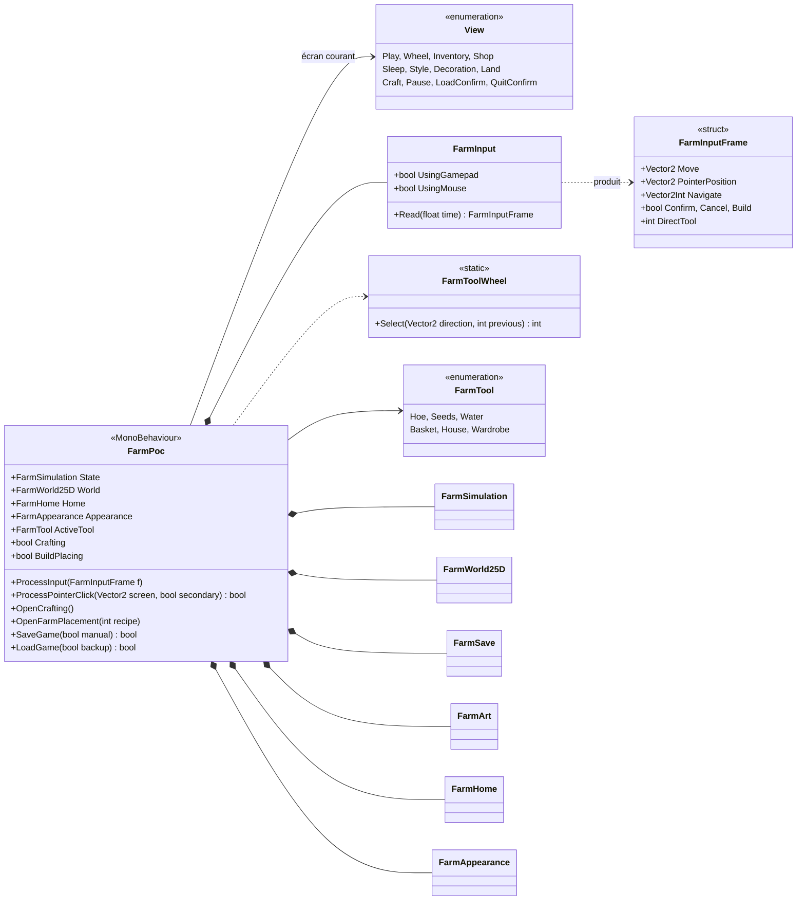
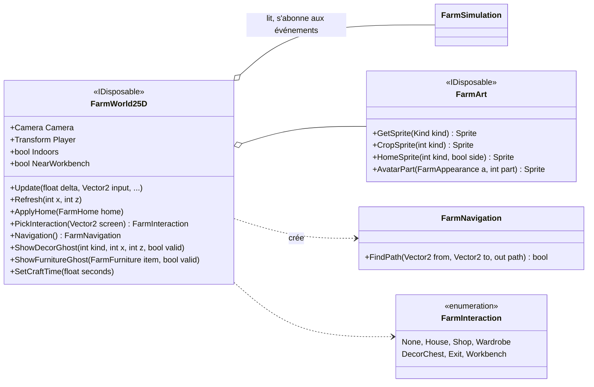
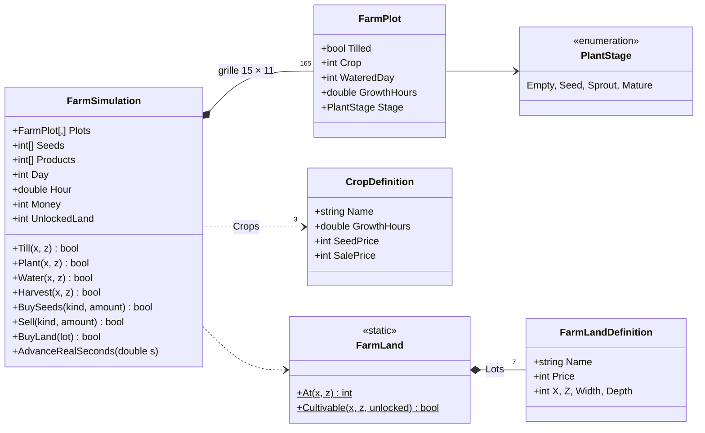
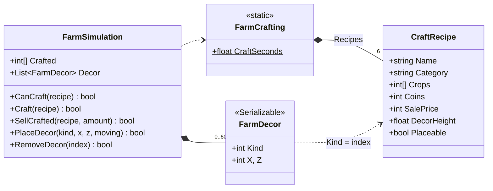
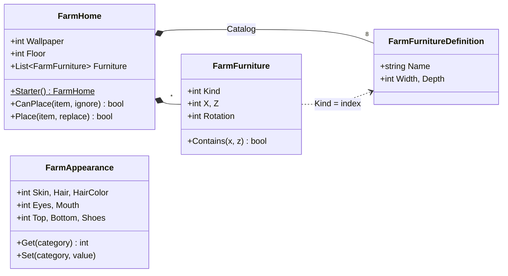
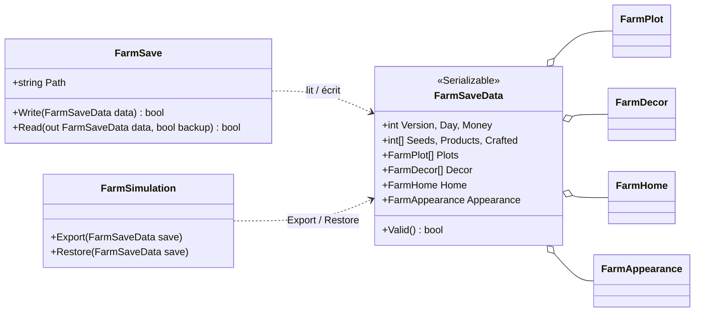

# Schéma UML — Farm Game POC

Architecture actuelle du code runtime (`Assets/Scripts`, hors outils éditeur), découpée en petits diagrammes lisibles.
Seuls les membres publics les plus utiles sont listés. Une classe venant d'un autre diagramme apparaît en boîte vide.

1. [Vue d'ensemble](#1-vue-densemble)
2. [Contrôle et entrées](#2-contrôle-et-entrées)
3. [Monde 2.5D](#3-monde-25d)
4. [Cultures et terrain](#4-cultures-et-terrain)
5. [Fabrication et décorations](#5-fabrication-et-décorations)
6. [Maison et personnage](#6-maison-et-personnage)
7. [Sauvegarde](#7-sauvegarde)
8. [Découpage des classes `partial`](#8-découpage-des-classes-partial)

## 1. Vue d'ensemble

## 2. Contrôle et entrées

`FarmPoc` est le seul `MonoBehaviour` : il lit les entrées, choisit l'écran affiché (`View`) et pilote tout le reste.

## 3. Monde 2.5D

`FarmWorld25D` construit la scène à partir de l'état de la simulation et se met à jour via ses événements.

## 4. Cultures et terrain

Partie « ferme » de `FarmSimulation` : temps, argent, parcelles et cultures.

## 5. Fabrication et décorations

Partie « établi » de `FarmSimulation` (fichier `FarmCrafting.cs`).

## 6. Maison et personnage

## 7. Sauvegarde

`FarmSimulation.Export` remplit un `FarmSaveData`, que `FarmSave` écrit en JSON ; `Restore` fait l'inverse.

## 8. Découpage des classes `partial`

| Classe | Fichiers | Responsabilité de chaque fichier |
|---|---|---|
| `FarmPoc` | `FarmPoc.cs` | Boucle `Update`, vues, HUD, inventaire, boutique |
| | `FarmPocHome.cs` | Maison, garde-robe, sauvegarde / chargement, pause |
| | `FarmPocMouse.cs` | Clics, déplacement à la souris, interactions |
| | `FarmPocCrafting.cs` | Catalogue de l'établi et animation de fabrication |
| | `FarmPocBuild.cs` | Menu de construction et pose (meubles + décorations) |
| `FarmWorld25D` | `FarmWorld25D.cs` | Scène extérieure, caméra, personnage, éclairage |
| | `FarmInterior25D.cs` | Intérieur de la maison et meubles |
| | `FarmWorldMouse.cs` | Picking, points d'approche, collisions de marche |
| | `FarmWorldCrafting.cs` | Établi et son animation |
| | `FarmWorldPlacement.cs` | Décorations posées et fantômes de pose |
| `FarmArt` | `FarmArt.cs`, `FarmCharacterArt.cs`, `FarmHomeArt.cs` | Sprites généraux, avatar, maison |
| `FarmSimulation` | `FarmSimulation.cs`, `FarmCrafting.cs` | Cultures / temps / argent, fabrication / décorations |
